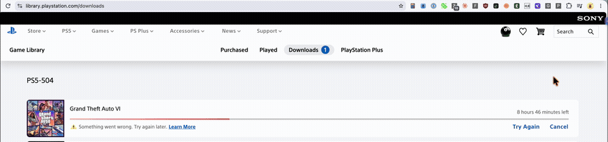

# PS Download Retry

A tiny Chrome extension that presses **Try Again** for you when a download to your PlayStation fails on the web Game Library page.

The PlayStation library page (`library.playstation.com/downloads`) shows "Something went wrong. Try again later." and a **Try Again** button when a remote download stalls. This extension watches the page and presses it whenever it appears, so a long download keeps going without you babysitting it.

## Install (2 minutes)
1. Download this repo (green **Code** button → **Download ZIP**) and unzip it.
2. Open `chrome://extensions` (works in Chrome, Edge, Brave, Helium and other Chromium browsers).
3. Turn on **Developer mode** (top right).
4. Click **Load unpacked** and choose the `extension` folder.
5. Open or reload your PlayStation **Game Library → Downloads** page and leave the tab open.

A small badge in the bottom-left corner says "PS Retry: watching" and counts each retry.

## How it works
- Runs only on `library.playstation.com`. No permissions, no network calls, no data collected.
- Looks for a visible button labelled "Try Again" on each page change and every 5 seconds, and presses it at most once every 20 seconds.
- About 50 lines of plain JavaScript: read `extension/content.js` before installing.

## Notes
- Not affiliated with or endorsed by Sony Interactive Entertainment. PlayStation is a trademark of Sony Interactive Entertainment.
- If Sony changes the button text, the extension will simply stop finding it. Open an issue.

Built with Claude in a couple of minutes.

## License
MIT
